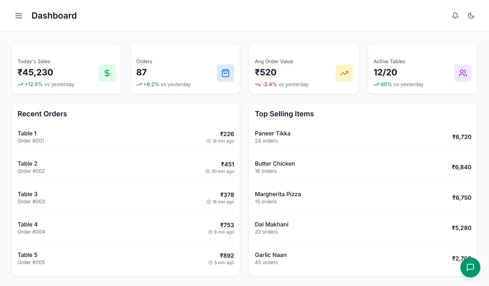
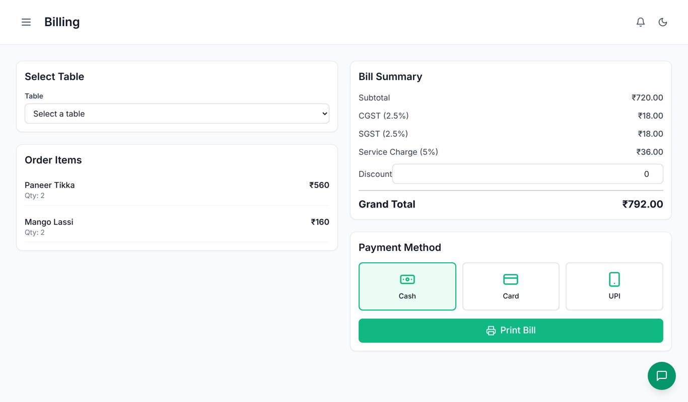
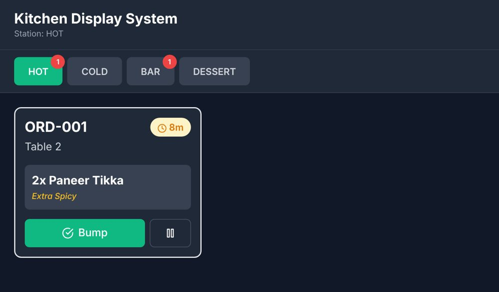

# Restaurant POS + Kitchen Display System 🍽️

A point-of-sale and kitchen display system (KDS) for restaurants, built with **React, TypeScript and Tailwind CSS**. Waiters take orders on a tablet, the kitchen sees tickets by station, cashiers generate GST bills, and managers track sales.



<p align="center">
  
  
</p>

## Features
- **Role-based login with PINs** for six roles: Admin, Manager, Cashier, Waiter, Kitchen, Storekeeper. Each role only sees its own screens (protected routes).
- **Waiter POS:** table map, menu by category, veg/non-veg markers, item modifiers, order summary, send to kitchen
- **Kitchen Display System:** tickets split by station (Hot / Cold / Bar / Dessert), colour-coded wait times, bump and hold
- **Billing:** CGST + SGST breakdown, service charge, discounts, cash / card / UPI
- **Menu, inventory, reports and settings** screens for managers and storekeepers
- **Notifications, dark mode and an FAQ chatbot** built into the layout
- Responsive layout for mobile, tablet and desktop

## Tech stack
| Area | Tools |
|---|---|
| Frontend | React 18, TypeScript, Vite, Tailwind CSS |
| State & routing | Zustand (with persistence), React Router |
| Forms & validation | React Hook Form, Zod |
| UI | Lucide icons, React Hot Toast, Recharts |
| Backend (optional) | Node.js, Express, MySQL (see [`backend/`](backend/) and [`database/`](database/)) |

The frontend runs fully on built-in sample data, so it works without a server. The `backend/` folder contains an Express REST API and a 14-table MySQL schema for orders, tables, menu, inventory and users. Connecting the frontend to it is the next step.

## Run it
```bash
git clone https://github.com/DhanushBattu/Hotel-management.git
cd Hotel-management
npm install
npm run dev        # http://localhost:5173
```
Other scripts: `npm run build` (type-check + production build), `npm run lint`.

### Demo logins
| Role | PIN | Lands on |
|---|---|---|
| Admin | 1234 | Dashboard (full access) |
| Manager | 2345 | Dashboard, reports, settings |
| Cashier | 3456 | Billing |
| Waiter | 4567 | Waiter POS |
| Kitchen | 5678 | Kitchen display |
| Storekeeper | 6789 | Inventory |

## Project structure
```
src/
├── components/      Layout, chatbot, notifications, reusable UI (Button, Card, Modal…)
├── pages/           Login, Dashboard, WaiterDashboard, KDS, Billing, Menu, Inventory, Reports, Settings
├── store/           Zustand stores: auth, orders, notifications, theme
├── data/            Sample menu, tables, orders and users
└── types/           Shared TypeScript types
backend/             Express API (routes for orders, KDS, menu, inventory, reports…)
database/            MySQL schema and setup guide
docs/                Setup and deployment guides, screenshots
```

## Roadmap
- Connect the frontend to the Express + MySQL API
- Live kitchen updates over WebSockets
- Receipt printer and payment gateway integration
